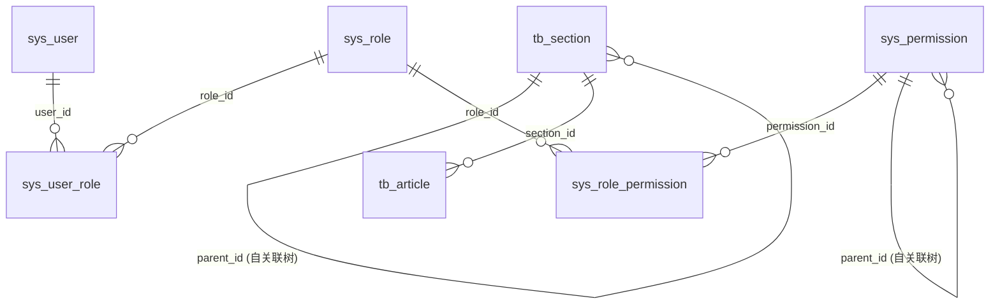

# Faster-CMS API 项目分析报告

> **版本说明**：本文档分析的是 1.0 版本（Shiro + 私有 `cn.org.faster` starter）。项目已于 2026-11 在 JDK 17 / Spring Boot 4.1.2 / Spring Framework 7.0.10 上整体重写为 2.0，新架构与用法见 [README.md](README.md)，变更清单见 [MIGRATION.md](MIGRATION.md)。1.0 的分析结论保留作为历史参考。

> 分析对象：`faster-framework/faster-framework-cms-api`（`/opt/projects/faster-framework-cms-api`）
> 版本：`1.0-SNAPSHOT` ｜ 分支：`master`（仅 1 次提交 `512bd92 初始化`）
> 许可：Apache License 2.0
> 分析方式：全量静态代码审查（94 个 Java 文件、5,863 行 Java 代码、5 个 FreeMarker 模板、1 份建表脚本）
> 分析日期：2026-11-13

---

## 0. 摘要（TL;DR）

Faster-CMS 是一个**基于 Spring Boot + MyBatis-Plus + Shiro/JWT + FreeMarker 的资讯型内容管理系统**，单体应用内同时承担三件事：

1. **站点前台渲染**：`/`、`/s/{栏目}`、`/a/{文章}` 由 FreeMarker 服务端渲染，并提供 `<@section>` / `<@article>` / `<@dict>` 三个自定义标签；
2. **站点静态化**：`POST /admin/site/generate` 全站生成 HTML 到本地目录，运行时由 `StaticInterceptor` 优先命中静态文件，未命中才回落到动态渲染；
3. **后台管理 API**：文章、栏目、字典、用户、角色、权限（RBAC）的 REST 接口，Shiro + JWT 鉴权、`@RequiresPermissions` 细粒度授权。

**整体评价**：架构思路清晰（"动态渲染 + 静态化 + 自定义标签"是典型 CMS 三段式），分层明确，代码风格统一（明显由代码生成器 `faster-builder` 产出）。但作为可投产项目，存在若干**阻断级问题**（无法开箱启动、私有依赖、循环依赖）、**功能性缺陷**（静态页写入未关闭流、栏目模板类型为空 NPE、发布时间被覆盖）以及**大量重复/死代码**（同一套查询条件构造被复制 3 份，8 个请求 DTO 完全未被引用，2 个模板文件逐字节相同）。

| 维度 | 评分 | 说明 |
|---|---|---|
| 架构设计 | ★★★☆☆ | 分层合理，但 api/admin 双份模型割裂，存在循环依赖 |
| 代码质量 | ★★☆☆☆ | 大量复制粘贴样板代码、死代码、未使用 import、错误吞掉 |
| 安全性 | ★★☆☆☆ | MD5 无盐、登出未失效 token、默认弱口令、上传匿名 |
| 性能 | ★★☆☆☆ | 全站生成串行且无缓存、`tb_article` 缺索引、列表查询退化为全表 |
| 可维护性 | ★★☆☆☆ | 无测试、无 CI、无 API 文档、框架代码内嵌（43 个类） |
| 文档与上手 | ★★★☆☆ | README 仅介绍与链接，配置项留空，无部署说明 |

---

## 1. 项目定位与能力边界

### 1.1 项目是什么

Faster-CMS 由两部分组成（见 [README.md](README.md)）：

| 仓库 | 职责 |
|---|---|
| `faster-framework-cms-web` | 后台管理前端页面（Vue 等，独立仓库） |
| **`faster-framework-cms-api`（本项目）** | 后台管理后端接口 + 站点前台页面与接口 |

本项目不是一个通用脚手架，而是**面向"企业官网 / 新闻站点"这类资讯型网站的内容管理内核**：

- 内容模型只有两级：**栏目（Section，树形）+ 文章（Article，属于某个栏目）**；
- 栏目决定"用哪个模板渲染"（`template_path` / `article_template_path`）与"是否分页"（`template_type` = 1 普通 / 2 分页）；
- 站点样式完全由 FreeMarker 模板决定，模板可以放在 `classpath:/templates/`（也可外置，取决于 FreeMarker 加载路径）；
- 提供**全站静态化**能力，生成结果可交给 Nginx 直接托管。

### 1.2 明确不包含的能力

阅读代码后可确认以下能力**不在**当前实现范围内（评估二次开发成本时需注意）：

- 无多站点 / 多语言 / 多租户；
- 无文章标签（tag）、评论、附件库（仅有通用上传接口）、检索（无 ES/Lucene）；
- 无草稿版本、审核流、定时发布（`publish_status` 只有 0/1，无定时任务）；
- 无缓存层（无 Redis / Caffeine 依赖）、无消息队列；
- 无接口文档（无 Swagger / OpenAPI）、无单元测试、无 CI/Docker 配置。

---

## 2. 技术栈与依赖

### 2.1 依赖清单（[pom.xml](pom.xml)）

```xml
<parent>
  <groupId>cn.org.faster</groupId>
  <artifactId>spring-boot-starters</artifactId>   <!-- 私有 BOM -->
  <version>1.3.5.RELEASE</version>
</parent>
<dependencies>
  cn.org.faster:spring-boot-starter-web      <!-- Web + 全局异常 + 上传 + 验证码 -->
  cn.org.faster:spring-boot-starter-dict     <!-- 字典 + DictFacade -->
  cn.org.faster:spring-boot-starter-mybatis  <!-- MyBatis-Plus + BaseEntity + 分页 -->
  cn.org.faster:spring-boot-starter-shiro    <!-- Shiro + JWT 过滤器 -->
</dependencies>
```

| 类别 | 组件 | 依据 |
|---|---|---|
| 运行时 | Spring Boot 2.x（`javax.*`、`WebMvcConfigurer`、`HandlerInterceptorAdapter`、`ErrorController#getErrorPath` 均已废弃于 Spring 5/6 之间） | 源码 import 与 API 使用方式 |
| Web | Spring MVC + 内嵌 Tomcat | `spring-boot-starter-web` |
| 持久层 | MyBatis-Plus（`ServiceImpl` / `LambdaQueryWrapper` / `IPage`） | 各 `*Service`、`*Mapper` |
| 安全 | Apache Shiro（`AuthorizingRealm`、`@RequiresPermissions`）+ JWT（`JwtService`） | `ShiroRealm`、`AuthService` |
| 模板 | FreeMarker 2.3.28（`DefaultObjectWrapperBuilder` 硬编码版本） | `BaseDirective`、`application.yml` |
| 工具 | Lombok、Hutool（`FileReader`、`Convert`、`MapUtil`） | `StaticInterceptor`、`TemplateMapUtils` |
| 数据库 | MySQL（`ENGINE=InnoDB`、`utf8mb4`、`ROW_FORMAT=DYNAMIC`） | [db/faster-cms.sql](db/faster-cms.sql) |
| 测试/断言库 | **AssertJ 被用于生产代码**（`org.assertj.core.util.Strings`） | [SectionStrategy.java:13](src/main/java/cn/org/faster/cms/admin/site/strategy/impl/SectionStrategy.java#L13) |

> ⚠️ **风险 1：私有依赖不可获取。** `pom.xml` 中 4 个 `cn.org.faster:*` 依赖没有声明 `<repositories>`，也不在 Maven Central。干净环境下 `mvn package` 会直接失败，必须先本地 `install` 或配置私服。这使项目**无法在 CI/新机器上复现构建**。
>
> ⚠️ **风险 2：生产代码依赖测试库。** `SectionStrategy` 使用 `org.assertj.core.util.Strings.formatIfArgs` 做字符串格式化。若 AssertJ 仅以 `test` scope 引入（Spring Boot 默认如此），**运行期会抛 `NoClassDefFoundError`**。应改用 `String.format`。（详见 §9 P1-3）

### 2.2 版本管理现状

- 项目自身版本 `1.0-SNAPSHOT`，父 BOM `1.3.5.RELEASE`——两者版本策略不一致，升级框架需整体对齐；
- 未声明 `maven.compiler.source/target`（依赖父 POM），未声明 `project.build.sourceEncoding`；
- `spring-boot-maven-plugin` 已配置，但**未配置 `mainClass`、分层打包、`finalName`**；
- `<resources>` 把 `src/main/java` 下的 `**/*.xml` 打进产物（为兼容 MyBatis XML 映射），但**本项目的 Mapper 全部基于注解/MP，没有任何 XML 映射文件**——该配置属于历史遗留。

---

## 3. 代码结构与规模

### 3.1 目录树（精简）

```
faster-framework-cms-api/
├── pom.xml
├── README.md
├── LICENSE                       # Apache-2.0
├── db/faster-cms.sql             # 建表 + 初始化数据（243 行）
└── src/main/
    ├── java/cn/org/faster/
    │   ├── cms/
    │   │   ├── Application.java            # @SpringBootApplication
    │   │   ├── admin/                      # 后台管理（21 个类）
    │   │   │   ├── article/{controller,entity,mapper,model/request,service}
    │   │   │   ├── section/{controller,entity,mapper,model/request,service}
    │   │   │   └── site/{controller,service,strategy{,&impl}}
    │   │   ├── api/                        # 前台读服务（15 个类）
    │   │   │   ├── article/{entity,mapper,model/request,service}
    │   │   │   ├── section/{entity,mapper,model/request,service}
    │   │   │   └── dict/service
    │   │   ├── common/                     # 公共设施（11 个类）
    │   │   │   ├── config/{CmsConfiguration,FreeMarkerConfig,StaticInterceptor}
    │   │   │   ├── directive/{BaseDirective,context,impl}
    │   │   │   ├── properties/CmsProperties
    │   │   │   └── utils/{CmsUtils,TemplateMapUtils}
    │   │   └── view/                       # 前台页面路由（3 个类）
    │   │       ├── index/IndexController
    │   │       ├── section/SectionController
    │   │       └── article/ArticleController
    │   └── framework/admin/                # 内嵌的后台基础能力（43 个类）
    │       ├── AdminScanConfiguration       # 通过 spring.factories 注册
    │       ├── auth / shiro / user / role / permission / rolePermission / userRole
    │       ├── dict
    │       └── basic（CaptchaController、UploadController）
    └── resources/
        ├── application{,-dev,-local,-test,-prod}.yml
        ├── META-INF/spring.factories
        ├── static/index.css                 # 0 字节（空文件）
        └── templates/{index.ftl,error.ftl,section/{normal,page}.ftl,article/article.ftl}
```

### 3.2 规模统计

| 指标 | 数值 |
|---|---|
| Java 文件 | 94 |
| Java 代码行 | 5,863 |
| `cms/common` | 11 个类 |
| `cms/api` | 15 个类 |
| `cms/admin` | 21 个类 |
| `cms/view` | 3 个类 |
| `framework/admin`（内嵌框架） | 43 个类 |
| REST 映射注解 | 51 处（含类级 `@RequestMapping`） |
| FreeMarker 模板 | 5 个（其中 `normal.ftl` 与 `page.ftl` **内容完全相同**） |
| SQL 脚本 | 243 行（8 张表 + 权限/角色/用户/字典种子数据） |
| 测试代码 | **0** |

> `framework/admin` 占全部 Java 文件的 45%，却属于"基础脚手架"而非业务代码，且以**源码形式内嵌**（不是依赖 jar）。它同时被 `META-INF/spring.factories` 注册为自动配置。这带来两个隐患：
> 1. 若 `spring-boot-starter-shiro` 内部也提供同名类，会出现 **classpath 上同名类冲突**（取决于 jar 加载顺序），或出现**重复 Bean 定义**；
> 2. 框架升级时需要**手工合并**这 43 个类，长期必然版本漂移。

---

## 4. 架构设计

### 4.1 分层视图

```
┌──────────────────────────────────────────────────────────────────────┐
│  表现层                                                              │
│  ├─ 前台动态页面  view.*Controller  → FreeMarker 模板 → HTML          │
│  ├─ 后台 REST 接口 admin.*Controller / framework.admin.*Controller    │
│  └─ 静态拦截器    common.config.StaticInterceptor（/** 优先命中静态） │
├──────────────────────────────────────────────────────────────────────┤
│  应用/领域服务层                                                     │
│  ├─ admin.article/section/site/...  → 写操作 + 校验 + 静态化编排      │
│  ├─ api.article/section/dict        → 只读查询（供模板标签/前台复用） │
│  └─ framework.admin.*Service        → RBAC 用户角色权限               │
├──────────────────────────────────────────────────────────────────────┤
│  模板扩展层  common.directive：<@section> <@article> <@dict>          │
├──────────────────────────────────────────────────────────────────────┤
│  持久层      MyBatis-Plus BaseMapper / ServiceImpl / BaseEntity       │
├──────────────────────────────────────────────────────────────────────┤
│  基础设施    CmsProperties（配置）、CmsUtils（文件/模板输出）、JWT/Shiro│
└──────────────────────────────────────────────────────────────────────┘
```

**关键设计取舍**：

- **前台与后台各有一套实体和服务**（`cms.api.*` vs `cms.admin.*`），虽然是同一批表（`tb_article`、`tb_section`），但 `api` 侧只做查询、`admin` 侧做增删改。这种"读写分离式的双模型"在 CMS 中有一定合理性（前台查询条件更简单、可裁剪字段），但当前实现是**纯复制**，没有共享基类或 DTO 映射，代价大于收益（见 §9 P2）。
- **静态化是"生成 + 拦截回放"模式**，不是 Nginx 直接托管：请求先进入 `StaticInterceptor`，命中则直接写出文件内容并中断链路（`return false`）。好处是无需额外 Web 服务器即可"静态化"，坏处是 Java 仍参与每次请求（无 CDN/协商缓存优势）。
- **模板标签与业务解耦良好**：`BaseDirective` 统一解析通用参数到 `TagContext`，子类只实现 `buildData()`。这是本项目最优雅的部分（见 §4.4）。

### 4.2 请求链路

#### (a) 动态页面

```
GET /s/news/2
  └─ StaticInterceptor.preHandle
        ├─ 命中 <siteDir>/s/news/2.html  → 直接写 HTML，return false（结束）
        └─ 未命中 → 继续
  └─ view.section.SectionController#list("news", 2)
        ├─ sectionService.query(code="news", publishStatus=1)
        ├─ 校验 section / templatePath 非空，否则抛 BasicErrorCode.ERROR（→ /error → error.ftl）
        ├─ sectionService.renderTemplate(section, current)
        │     ├─ s = 当前栏目, p = 父栏目, plist = 祖先列表
        │     └─ 若 templateType == 2：追加 current/size/pages/total/hasp/hasn/nnum/pnum
        └─ return section.getTemplatePath()  → FreeMarker 渲染 → HTML
```

#### (b) 文章详情

```
GET /a/{id}
  └─ view.article.ArticleController#info(id)
        ├─ articleService.getById(id)；为 null 或 publishStatus==0 → 404
        ├─ section = sectionService.getById(article.sectionId)；无 articleTemplatePath → 404
        ├─ articleService.renderTemplate(article, section) → {art, ps, pslist}
        └─ return section.getArticleTemplatePath()
```

#### (c) 静态化生成

```
POST /admin/site/generate           （@RequiresPermissions("site:manage")）
  └─ admin.site.SiteService#generate()       @Transactional  ← 注意：全站文件 IO 在事务内
        ├─ IndexStrategy.start()             → <siteDir>/index.html
        └─ SectionStrategy.start()           → 递归遍历栏目树
              ├─ 无 templatePath 跳过
              ├─ templateType=1 → <siteDir>/s/{code}.html
              ├─ templateType=2 → <siteDir>/s/{code}/{n}.html（1..totalPages）
              │                   并额外把第 1 页写入 <siteDir>/s/{code}.html
              └─ 若栏目有 articleTemplatePath → 该栏目下所有已发布文章
                    → <siteDir>/a/{articleId}.html
```

#### (d) 鉴权链路

```
POST /admin/login  （shiro anon）
  ├─ captchaService.valid(captcha, captchaToken)
  ├─ 账号查库；password 比对 md5(明文)
  ├─ jwtService.createToken(userId, -1)     ← -1 语义待确认（通常为"永不过期"）
  ├─ subject.login(token)  → ShiroRealm#doGetAuthenticationInfo
  │     ├─ parseToken → claims.audience = userId
  │     ├─ 若非多端登录：比对缓存 AUTH_TOKEN_PREFIX+userId 与请求 token
  │     └─ 写入 RequestContext.userId
  └─ 返回 { token }

GET /admin/**（shiro jwt 过滤器）
  ├─ JWT 校验 → ShiroRealm#doGetAuthorizationInfo
  │     ├─ roleId == 0 → 视为超级管理员，授予全部权限 code
  │     └─ 否则 user_role → role_permission → permission.code
  └─ @RequiresPermissions("article:list") 等注解校验
```

### 4.3 配置装配

| 配置类 | 作用 |
|---|---|
| [CmsConfiguration](src/main/java/cn/org/faster/cms/common/config/CmsConfiguration.java) | 注册 `StaticInterceptor` 到 `/**`；`@PostConstruct` 在未配置 `app.cms.site-dir` 时默认取 `classpath 根 + /site` |
| [FreeMarkerConfig](src/main/java/cn/org/faster/cms/common/config/FreeMarkerConfig.java) | 扫描所有 `BaseDirective` Bean，**以 Bean 名注册为模板共享变量**（`article` / `section` / `dict`） |
| [CmsProperties](src/main/java/cn/org/faster/cms/common/properties/CmsProperties.java) | `app.cms.site-dir`、`page-size`（默认 20）、`context-prefix`（默认 `cms`） |
| [AdminScanConfiguration](src/main/java/cn/org/faster/framework/admin/AdminScanConfiguration.java) | 通过 `spring.factories` 注册，`@ComponentScan` 扫描 `cn.org.faster.framework.admin` 包 |

> 设计要点：**标签名 = Spring Bean 名**（`@Component("article")`）。新增一个标签只需实现 `BaseDirective` 并起一个 Bean 名，无需改配置——扩展性良好。

### 4.4 自定义模板标签（本项目核心亮点）

统一入口 [BaseDirective](src/main/java/cn/org/faster/cms/common/directive/BaseDirective.java) 负责把 FreeMarker 标签参数解析为 `TagContext`，子类只实现 `buildData()`，返回值被包装成模板变量（默认名 `data`，可用 `as` 改名）。

**通用属性表**（`TagContext`）：

| 属性 | 类型 | 默认 | 语义 |
|---|---|---|---|
| `list` | bool | false | 列表模式，返回**全部**记录（实现上借助分页 `size=-1`） |
| `page` | bool | false | 分页模式，返回当前页记录，页码/页长取自全局 `cms.current` / `cms.size` |
| `size` / `current` | int | -1 | 显式指定页长/页码；`list` 模式下默认 -1（不分页） |
| `id` | long | null | 主键 |
| `code` | string | null | 栏目/文章/字典 编码 |
| `pid` | long | null | 栏目父 id |
| `pcode` | string | null | 父栏目**编码**（内部反查 pid） |
| `scode` | string | null | 栏目编码（文章标签用，反查 sectionId） |
| `sid` | long | null | 栏目 id（文章标签用） |
| `show` | bool | **true** | 是否只取"列表展示"数据（映射 `show_status`） |
| `top` | bool | null | 是否置顶（映射 `top_status`） |
| `exclude` | long | null | 排除某个 id（`ne`） |
| `type` / `name` | string | null | 字典类型 / 名称 |
| `alias`(`as`) | string | `data` | 输出变量名 |

**行为矩阵**：

| 标签 | `list=true` | `page=true` | 默认（单条） |
|---|---|---|---|
| `<@section>` | `page()` 全量 → `records` | `page()` 当前页 → `records` | `query()` → 单对象 |
| `<@article>` | 同上 | 同上 | 同上 |
| `<@dict>` | 同上 | 同上 | 同上 |

三个标签都会**强制 `publish_status = 1`**，即前台永远只能看到已发布内容——这是正确的默认安全边界。

**使用示例**（摘自 [section/page.ftl](src/main/resources/templates/section/page.ftl)）：

```freemarker
<@section list=true pid='${cms.s.id}'>
  <#list data as item>${item.name}<br/></#list>
</@section>

<@article list=true show=false scode='${cms.s.code}'>
  <#list data as item>${item.title}<br/></#list>
</@article>

<@dict name='a' type='b'>${data.dictValue}</@dict>
```

**模板可用上下文变量**：

| 场景 | 变量 |
|---|---|
| 全部（前缀由 `app.cms.context-prefix` 决定，默认 `cms`） | `cms` |
| 栏目页 | `cms.s`（当前栏目）、`cms.p`（父栏目，可能为 null）、`cms.plist`（祖先列表） |
| 栏目分页页 | `cms.current`、`cms.size`、`cms.pages`、`cms.total`、`cms.hasp`、`cms.hasn`、`cms.pnum`、`cms.nnum` |
| 文章页 | `cms.art`、`cms.ps`（所属栏目）、`cms.pslist`（祖先链 + 当前栏目） |
| 首页 | 空 Map |

> ⚠️ 注意 `application.yml` 中 `spring.freemarker.settings.classic_compatible: true`：该配置让**未定义变量不至于抛异常**，而是输出空。好处是模板容错，坏处是**模板写错字段名会被静默吞掉**（例如 `article.ftl` 里 `${cms.art.name}` 应为 `title`，见 §9 P1-6）。

---

## 5. 数据模型

### 5.1 表清单（[db/faster-cms.sql](db/faster-cms.sql)）

| 表 | 说明 | 关键字段 | 索引情况 |
|---|---|---|---|
| `tb_section` | 栏目（树形） | `parent_id`、`parent_ids`、`template_type`、`template_path`、`article_template_path`、`publish_status`、`show_status`、`top_status` | **无 code 唯一索引**，无 parent_id 索引 |
| `tb_article` | 文章 | `section_id`、`publish_status`、`publish_date`、`show_status`、`top_status`、`content` | **仅主键**，`section_id`/`publish_status` 无索引 |
| `sys_user` | 后台用户 | `account`、`password`(MD5) | `uk_account` |
| `sys_role` | 角色 | `name` | 主键 |
| `sys_permission` | 权限（树形） | `code`、`parent_id`、`parent_ids` | 仅主键 |
| `sys_role_permission` | 角色-权限 | `role_id`、`permission_id` | **无** |
| `sys_user_role` | 用户-角色 | `user_id`、`role_id` | **无** |
| `sys_dict` | 字典 | `name`、`type`、`dict_value` | `idx_type`、`idx_name` |

### 5.2 ER 关系



### 5.3 公共字段约定（`BaseEntity`，由 mybatis starter 提供）

所有业务表都带同一组字段（与 SQL 一一对应）：

```
id BIGINT PK  | create_by | update_by | create_date | update_date
sort INT      | remark    | deleted TINYINT (0/1)
```

并通过 `BaseEntity` 暴露：

- `preInsert()` / `preUpdate()`：填充 id（雪花算法）、时间、操作人；
- `toPage()`：把 `current` / `size` 转换为 MyBatis-Plus 的 `Page`（由 `list()` 请求参数直接绑定，说明 `BaseEntity` 还携带 `current`/`size` 两个非持久化字段）。

> ⚠️ **待确认（影响面较大）**：`BaseEntity.deleted` 是否标注 `@TableLogic`？
> - 若是：MP 会自动追加 `deleted = 0`，逻辑删除语义完整；
> - 若否：**所有查询都不会过滤已删除记录**，`removeById` 会变成物理删除 or 逻辑删除但查询泄漏。
>
> 代码层面仅在**显式传入** `deleted` 时才拼条件（如 [api/ArticleService.java:86-88](src/main/java/cn/org/faster/cms/api/article/service/ArticleService.java#L86-L88)），仓库内无 `@TableLogic` 声明，因此必须查看框架源码确认。

### 5.4 树形结构实现

- 冗余路径字段 `parent_ids`，格式为 `[0],[37614050900705280]`（SQL 种子数据可见），带方括号是为了**可按字符串排序**并便于 `LIKE '%[id]%'` 查子孙；
- 根节点 `parent_id = 0`，`parent_ids = '[0]'`；
- 删除权限时使用 `like(SysPermission::getParentIds, "[id]")` 递归删除子孙（[SysPermissionService.java:141-153](src/main/java/cn/org/faster/framework/admin/permission/service/SysPermissionService.java#L141-L153)）；
- 前端展示树用 `TreeUtils.convertToTree(list)`（框架提供）。

---

## 6. 接口清单

### 6.1 前台站点路由

| 方法 | 路径 | 说明 | 鉴权 |
|---|---|---|---|
| GET | `/` | 首页（`index.ftl`） | 公开 |
| GET | `/s/{sectionCode}` | 栏目页（普通/分页第 1 页） | 公开 |
| GET | `/s/{sectionCode}/{current}` | 栏目分页页 | 公开 |
| GET | `/a/{id}` | 文章详情 | 公开 |
| GET | `/error` | 404 页（`error.ftl`） | 公开 |
| GET | `/redirectError` | `server.error.path` 指向此，重定向到 `/error` | 公开 |
| GET | `/**` | 若 `<siteDir><uri>.html` 存在则直接返回静态页 | 公开 |

### 6.2 后台接口（统一前缀 `/admin`，Shiro `jwt` 过滤）

**认证 / 基础**

| 方法 | 路径 | 权限 | 说明 |
|---|---|---|---|
| POST | `/admin/login` | anon | 账号+密码+图形验证码登录，返回 JWT |
| GET | `/admin/userInfo` | jwt | 当前用户名 + 全部权限 code |
| DELETE | `/admin/logout` | jwt | 退出（清理授权缓存） |
| GET | `/admin/captcha/**` | anon | 图形验证码（继承 `AbstractCaptchaController`） |
| POST | `/admin/**`（继承） | anon（`/admin/media/**`） | 文件上传（继承 `AbstractUploadController`） |

**文章 `/admin/article`**

| 方法 | 路径 | 权限 | 说明 |
|---|---|---|---|
| GET | `/admin/article` | `article:list` | 分页列表 |
| GET | `/admin/article/{id}` | `article:info` | 详情 |
| GET | `/admin/article/query` | `article:info` | 条件查单条 |
| POST | `/admin/article` | `article:add` | 新增（code 唯一校验、已发布则写 `publish_date`） |
| PUT | `/admin/article/{id}` | `article:modify` | 更新（code 唯一校验） |
| DELETE | `/admin/article/delete` | `article:delete` | 批量删除（body 为 id 数组） |

**栏目 `/admin/section`**

| 方法 | 路径 | 权限 | 说明 |
|---|---|---|---|
| GET | `/admin/section/tree` | `section:tree` | 栏目树 |
| GET | `/admin/section` | `section:list` | 全量列表（**无分页**） |
| GET | `/admin/section/{id}` | `section:info` | 详情 |
| GET | `/admin/section/query` | `section:info` | 条件查单条 |
| POST | `/admin/section` | `section:add` | 新增（自动补 `parent_ids`、继承父模板） |
| PUT | `/admin/section/{id}` | `section:modify` | 更新 |
| DELETE | `/admin/section/delete` | `section:delete` | 批量删除 |

**站点 `/admin/site`**

| 方法 | 路径 | 权限 | 说明 |
|---|---|---|---|
| POST | `/admin/site/generate` | `site:manage` | 全站静态化 |

**字典 `/admin/sys/dict`**

| 方法 | 路径 | 权限 |
|---|---|---|
| GET | `/all` | jwt（无权限注解） |
| GET | `` | `dict:list` |
| GET | `/{id}`、`/query` | `dict:info` |
| POST | `` | `dict:add` |
| PUT | `/{id}` | `dict:modify` |
| DELETE | `/delete` | `dict:delete` |

**用户 / 角色 / 权限**（`/admin/sys/users`、`/admin/sys/roles`、`/admin/sys/permissions`）

标准 CRUD + 关系维护：

| 接口 | 权限 |
|---|---|
| `GET/POST/PUT/DELETE /admin/sys/users...` | `users:list/info/add/modify/delete` |
| `PUT /admin/sys/users/{id}/password/change` | `users:password:change` |
| `PUT /admin/sys/users/{id}/password/reset` | `users:password:reset` |
| `PUT /admin/sys/users/{id}/roles/choose`、`GET .../roles` | `users:roles:choose`、`users:roles:list` |
| `GET/POST/PUT/DELETE /admin/sys/roles...` | `roles:list/info/add/modify/delete` |
| `PUT /admin/sys/roles/{id}/permissions/choose`、`GET .../permissions` | `roles:permissions:choose`、`roles:permissions:list` |
| `GET/POST/PUT/DELETE /admin/sys/permissions...`（含 `/tree`） | `permissions:list/tree/info/add/modify/delete` |

> 权限 code 全集见 SQL 第 45–89 行，共 **45 条**，覆盖 7 个模块：`permissions`(7)、`roles`(8)、`users`(10)、`dict`(6)、`article`(6)、`section`(7)、`site`(1)。

### 6.3 约定与风格

- 全部使用 `ResponseEntity`，成功：`200`（查询）/ `201`（新增、修改）/ `204`（删除）；
- 错误响应由框架 `ResponseErrorEntity.error(ErrorCode, HttpStatus)` 统一构造（body 结构由 starter 定义）；
- 业务错误用枚举 `ErrorCode`：`AuthError(1100-1102)`、`SysPermissionError(1110-1111)`、`RoleError(1120)`、`UserError(1130-1133)`、`RolePermissionError(1140)`；
- **删除接口统一 `DELETE /delete` + `@RequestBody List<Long>`**（非 RESTful 风格，但与前端约定一致）。

---

## 7. 配置说明

### 7.1 配置文件矩阵

| 文件 | 用途 | 关键差异 |
|---|---|---|
| [application.yml](src/main/resources/application.yml) | 主配置 | 引入 `web`、`mybatis` profile；FreeMarker `suffix: ""`、`classic_compatible: true`、`number_format: 0.##`；Shiro 过滤链；`server.error.path=/redirectError`；MP `local-cache-scope: statement` |
| [application-dev.yml](src/main/resources/application-dev.yml) | 开发 | 上传目录 `/data/upload/faster-cms`，DEBUG 日志 |
| [application-local.yml](src/main/resources/application-local.yml) | 本机 | **硬编码** `/Users/zhangbowen/data/upload/faster-cms` |
| [application-test.yml](src/main/resources/application-test.yml) | 测试 | 与 prod 相同（无差异化） |
| [application-prod.yml](src/main/resources/application-prod.yml) | 生产 | 无 DEBUG，无连接池/日志/监控增强 |

### 7.2 关键配置项

```yaml
app:
  group: faster-cms          # 由框架使用（缓存 key 前缀等）
  datasource:                # ⚠️ 全部为空，需要自行填写
    name/host/port/username/password
  upload:
    local.file-dir / url-prefix
  shiro:
    filter-chain-definition-map:
      /admin/login:    anon
      /admin/media/**: anon      # 上传接口匿名
      /admin/captcha/**: anon
      /admin/**:       jwt
  cms:                       # CmsProperties 未在 yml 中出现 → 全部走默认值
    site-dir: <jar 根>/site
    page-size: 20
    context-prefix: cms
```

### 7.3 环境要求与运行

| 项 | 要求 |
|---|---|
| JDK | 8+（代码使用 `javax.*`、Stream、Lombok） |
| Maven | 3.5+，**且能访问 `cn.org.faster:*` 制品** |
| MySQL | 5.7 / 8.0，`utf8mb4` |
| 磁盘 | 静态化输出目录 `site-dir` 可写；上传目录可写 |

```bash
# 1. 初始化数据库
mysql -uroot -p -e "CREATE DATABASE \`faster-cms\` DEFAULT CHARSET utf8mb4;"
mysql -uroot -p faster-cms < db/faster-cms.sql

# 2. 配置数据源（application-dev.yml 的 app.datasource.* 必填）

# 3. 启动
mvn spring-boot:run -Dspring-boot.run.profiles=dev
# 或
mvn clean package -DskipTests && java -jar target/faster-cms-api-1.0-SNAPSHOT.jar --spring.profiles.active=prod
```

默认账号：`admin / admin`（SQL 中 MD5 `21232f297a57a5a743894a0e4a801fc3` 即 `admin` 的 MD5）。

> 本次分析环境**未安装 JDK/Maven**（`java: command not found`、`mvn: command not found`，且 `~/.m2` 不存在），因此报告中的结论均来自静态审查，**未执行编译、启动与端到端验证**。

---

## 8. 运行时行为与一致性分析

### 8.1 动态渲染 vs 静态生成的一致性

同一页面存在**两套渲染代码**，必须保持上下文变量完全一致，否则"动态看到的"与"静态生成的"会不一样：

| 变量 | 动态（`api.SectionService.renderTemplate`） | 静态（`SectionStrategy`） | 一致？ |
|---|---|---|---|
| `s` | ✅ 当前栏目 | ✅ | ✅ |
| `p` | ✅ `getById(parentId)` | ✅ `parentList` 最后一个 | ✅ |
| `plist` | ✅ `listByIds(parentIds)` | ✅ 递归累积的父链 | ⚠️ 顺序/内容可能不同 |
| `current/size/pages/total/hasp/hasn/nnum/pnum` | ✅ 仅 `templateType==2` | ✅ 仅分页 | ✅ |
| 文章页 `art/ps/pslist` | ✅ | ✅ | ✅（但 `pslist` 顺序不同：动态是 `listByIds` 的 DB 顺序 + 追加当前栏目） |

**风险点**：`api.SectionService.renderTemplate` 用 `listByIds(parentIds)` 取祖先，返回顺序由数据库决定（`IN` 查询不保证顺序），而静态生成用递归累积（严格的由根到父顺序）。模板若依赖 `plist` 顺序做面包屑，**动态与静态结果会不一致**。同样 `pslist` 在动态路径下把当前栏目追加在末尾，而静态路径是"父链 + 当前栏目"，两者在多层栏目下顺序不同。

### 8.2 分页语义

- 动态：`/s/{code}/{current}` → `renderPageTemplate` 先执行一次分页查询（`current=1, size=pageSize`）**仅为拿 `total` 计算总页数**，随后模板中的 `<@article page=true>` 又执行一次查询——**每次请求 2 次查询**，其中第一次还带回了一整页数据（浪费）。应改用 `count` 或 `Page` 只取 total（`selectCount`）。
- 静态：`SectionStrategy.generatePageSection` 同样先查一次拿总页数，然后 **对每一页都重新渲染模板**，而模板内的 `<@article page=true>` 会按 `cms.current` 再查一次——**总查询数 ≈ 页数 × 2**。
- `totalPages == 0` 时（栏目下无已发布文章），**不会生成任何分页页面，也不会生成 `/s/{code}.html`**，导致该栏目静态页 404（回落动态渲染，通常能正常显示，但静态站会缺失该页面）。

### 8.3 静态文件生命周期

| 场景 | 期望 | 实际 |
|---|---|---|
| 发布/修改文章 | 重新生成对应 `/a/{id}.html` | ❌ 不自动，需手动 `POST /admin/site/generate` |
| 文章下线/删除 | 删除 `/a/{id}.html` | ❌ 文件残留，**静态拦截器会继续返回已下线内容**（严重） |
| 栏目改名/code 变更 | 旧目录清理 | ❌ 旧文件残留 |
| 模板变更 | 全站重生成 | ⚠️ 需手动触发；已生成页面无版本号/ETag 机制 |

> 这是"生成式静态化"的经典一致性问题：**只有"生成"没有"失效"**。生产环境若 Nginx 直接托管该目录，下线内容仍可通过静态 URL 访问，等同于**内容越权可见**。

### 8.4 异常处理

- 前台：`BasicErrorCode.ERROR.throwException()` → 框架全局异常处理 → 重定向 `/error` → `error.ftl`（固定 404 文案，**不区分 404/500**）；
- 静态生成：`BaseStrategy.start()` **捕获 `IOException | TemplateException` 后仅 `printStackTrace()`**，`SiteService.generate()` 无条件返回 `200 OK`。→ **生成失败对调用方完全不可见**（见 §9 P1-2）；
- `CmsUtils.getJarRootPath()` 同样吞异常返回 `null`，若失败则 `siteDir = "null/site"`。

---

## 9. 问题清单（按严重程度）

### P0 — 阻断级 / 高危

| # | 问题 | 证据 | 影响 |
|---|---|---|---|
| **P0-1** | **循环依赖**：`api.ArticleService` 注入 `SectionService`，`api.SectionService` 注入 `ArticleService` | [api/ArticleService.java:28](src/main/java/cn/org/faster/cms/api/article/service/ArticleService.java#L28)、[api/SectionService.java:31](src/main/java/cn/org/faster/cms/api/section/service/SectionService.java#L31) | Spring Boot ≥ 2.6 默认 `allow-circular-references=false`，**启动直接失败**；即使当前版本可启动，也是脆弱设计。解法：抽出 `SectionQueryService`（只读、无反向依赖）或改用 `@Lazy`/`ObjectProvider` |
| **P0-2** | **数据源配置为空**，无法开箱启动 | 4 个 profile 的 `app.datasource.*` 全空，`application.yml` 无 `spring.datasource.url`，也无 `server.port` | 新人克隆后必然启动失败，且错误信息不直观 |
| **P0-3** | **私有依赖无法构建**：4 个 `cn.org.faster:*` 无 `<repositories>`，本地 `~/.m2` 也不存在 | [pom.xml](pom.xml) | 无法在 CI / 新机器构建，项目"不可复现" |
| **P0-4** | **默认弱口令** `admin/admin` 且**密码 MD5 无盐**，重置密码固定为 `123456` | SQL:155、[SysUserService.java:121](src/main/java/cn/org/faster/framework/admin/user/service/SysUserService.java#L121) | 彩虹表可直接反查；生产环境强风险 |
| **P0-5** | **登出未失效 token**：只清理了**授权缓存**，未清理 `AUTH_TOKEN_PREFIX + userId` 的 token 缓存 | [AuthService.java:83-88](src/main/java/cn/org/faster/framework/admin/auth/service/AuthService.java#L83-L88) | 退出后旧 token 在过期前仍可调用接口（若 `createToken(id, -1)` 表示永不过期，则**永久有效**） |
| **P0-6** | **上传接口匿名**且同时映射到根路径 `""` | [application.yml:18](src/main/resources/application.yml#L18)（`/admin/media/**: anon`）、[UploadController.java:8](src/main/java/cn/org/faster/framework/admin/basic/controller/UploadController.java#L8) | 任意人可上传文件；若框架未限制扩展名/大小/落盘路径，可导致存储滥用甚至 GetShell |

### P1 — 功能性缺陷 / 数据正确性

| # | 问题 | 证据 | 影响 |
|---|---|---|---|
| **P1-1** | **静态页写入未关闭流**：`new FileWriter(...)` 后直接 `template.process()`，无 `close()`/try-with-resources | [CmsUtils.java:32-40](src/main/java/cn/org/faster/cms/common/utils/CmsUtils.java#L32-L40) | 文件句柄泄漏；缓冲区未 flush 时可能产生**截断/空白的 HTML**；全站生成时会耗尽 fd |
| **P1-2** | **静态化失败静默**：`start()` 吞掉异常仅打印栈，`generate()` 恒返回 200 | [BaseStrategy.java:33-39](src/main/java/cn/org/faster/cms/admin/site/strategy/BaseStrategy.java#L33-L39)、[SiteService.java:27-33](src/main/java/cn/org/faster/cms/admin/site/service/SiteService.java#L27-L33) | 管理员以为生成成功，实际站点残缺 |
| **P1-3** | **生产代码依赖 AssertJ**：`org.assertj.core.util.Strings.formatIfArgs` | [SectionStrategy.java:13](src/main/java/cn/org/faster/cms/admin/site/strategy/impl/SectionStrategy.java#L13) | 若 AssertJ 为 test scope → `NoClassDefFoundError`，静态化直接不可用 |
| **P1-4** | **`Integer` 拆箱 NPE**：`section.getTemplateType() == 2` / `switch (getTemplateType())`，而 DB 列 `template_type` **可为 NULL** | [api/SectionService.java:248](src/main/java/cn/org/faster/cms/api/section/service/SectionService.java#L248)、[SectionStrategy.java:84](src/main/java/cn/org/faster/cms/admin/site/strategy/impl/SectionStrategy.java#L84) | 老数据/漏填模板类型时，栏目页 500、全站生成中断 |
| **P1-5** | **更新时间覆盖发布时间**：只要 `publishStatus==1` 就把 `publishDate` 改为 `now` | [admin/ArticleService.java:243-245](src/main/java/cn/org/faster/cms/admin/article/service/ArticleService.java#L243-L245)、[admin/ArticleService.java:262-266](src/main/java/cn/org/faster/cms/admin/article/service/ArticleService.java#L262-L266) | 编辑一次"标题"就会把发布时间改成今天，**排序与时间线全部错乱** |
| **P1-6** | **模板字段名错误**：`${cms.art.name}`，`Article` 无 `name` 字段（应为 `title`） | [article.ftl:7](src/main/resources/templates/article/article.ftl#L7) | 受 `classic_compatible=true` 影响**静默输出空**，文章页没有标题 |
| **P1-7** | **栏目移动不重算 `parent_ids`**：`update()` 只做 code 校验，未调用 `completeParentIds()` | [admin/SectionService.java:182-196](src/main/java/cn/org/faster/cms/admin/section/service/SectionService.java#L182-L196) | 调整栏目层级后树结构/面包屑/子栏目查询全部错乱（历史脏数据不可逆） |
| **P1-8** | **静态页无失效机制**：删除/下线文章、改栏目 code 均不清理已生成 HTML | §8.3 | 已下线内容仍可通过静态 URL 访问；旧页面长期残留 |
| **P1-9** | **查询条件全为精确匹配**：标题、描述、备注均 `eq` | [admin/ArticleService.java:101-103](src/main/java/cn/org/faster/cms/admin/article/service/ArticleService.java#L101-L103) 等 | 后台"按标题搜索"实际只能全字匹配，**基本不可用**（用户/角色/字典侧用的是 `likeRight`，风格还不统一） |
| **P1-10** | **静态拦截器路径拼接**：`fileDirName` 恒为空字符串（`substring(0, indexOf("/"))`），`fileName` 以 `/` 开头才"恰好"正确；且未 `normalize()` 校验 | [StaticInterceptor.java:34-38](src/main/java/cn/org/faster/cms/common/config/StaticInterceptor.java#L34-L38) | 代码意图不清（死代码）；若容器对 URI 做归一化，存在**路径穿越读取任意 `.html`** 的可能（建议 `Paths.get(siteDir).resolve(uri).normalize()` + `startsWith` 校验） |
| **P1-11** | **删除管理员保护未实现**：`UserError.ADMIN_CANNOT_DELETE`、`RoleError.ADMIN_CANNOT_DELETE` 定义但从未使用；仅 Controller 里 `if (item == 0L) return;` 跳过 | [SysUserController.java:92-97](src/main/java/cn/org/faster/framework/admin/user/controller/SysUserController.java#L92-L97) | Service 层可被其它入口绕过；批量接口里 `null` 元素会 NPE |

### P2 — 可维护性 / 工程化

| # | 问题 | 证据 |
|---|---|---|
| P2-1 | **8 个 DTO 完全未被引用**（`cms/api/*/model/request/*`），仅出现在自身 package 声明里 | grep `api.article.model\|api.section.model` 只命中定义行 |
| P2-2 | `SectionListRequest` 两份（admin/api）均未使用；admin 的 `SectionController#list()` 甚至不接收参数 | 同上 |
| P2-3 | **查询条件构造重复 3 次**（admin `listAll`/`list`/`query` 各约 56 行，几乎逐行相同）；api 侧 `page`/`query` 亦然 → 全项目约 500 行样板代码 | [admin/ArticleService.java](src/main/java/cn/org/faster/cms/admin/article/service/ArticleService.java)（291 行中约 168 行是重复的条件构造） |
| P2-4 | **实体/DTO 三份重复**：`admin.Article`、`api.Article`、`admin.Article*Request`；`Section` 同理 | 各 `entity/`、`model/request/` |
| P2-5 | 未使用 import：`admin/ArticleService` 中的 `Section`、`LocalDateTime`；`api` 侧实体 `Article` 同样残留 `Section`/`LocalDateTime` 引用 | [admin/ArticleService.java:5](src/main/java/cn/org/faster/cms/admin/article/service/ArticleService.java#L5) |
| P2-6 | **无任何测试**（`src/test` 不存在）、无 CI、无 Dockerfile、无 API 文档 | 目录结构 |
| P2-7 | `framework/admin` 43 个类内嵌，与 starter 潜在冲突且升级需手工合并 | §3.2 |
| P2-8 | 模板为演示性质：`section/normal.ftl` 与 `section/page.ftl` **完全相同**（105 行逐字节一致），且引用了普通页不存在的 `cms.current` 等变量 | diff 两文件 |
| P2-9 | 空文件 `static/index.css`；`README` 无部署/配置说明 | — |
| P2-10 | 废弃 API：`HandlerInterceptorAdapter`、`ErrorController#getErrorPath`；`@RequestMapping` 无 value（`IndexController`） | [StaticInterceptor](src/main/java/cn/org/faster/cms/common/config/StaticInterceptor.java)、[IndexController](src/main/java/cn/org/faster/cms/view/index/IndexController.java) |
| P2-11 | 硬编码个人路径 `/Users/zhangbowen/...` 进入版本库 | [application-local.yml:10](src/main/resources/application-local.yml#L10) |
| P2-12 | `BaseDirective` 对**无 body 的自闭合标签**（`<@article list=true/>`）会 NPE：`templateDirectiveBody.render(...)` 未判空；且 `list`/`page` 两个分支代码完全相同（可合并） | [BaseDirective.java:64-69](src/main/java/cn/org/faster/cms/common/directive/BaseDirective.java#L64-L69) |
| P2-13 | 隐式契约：`list=true` 依赖 MyBatis-Plus "`size < 0` 不分页"的行为；`show` 默认 `true` 使"取隐藏内容"必须显式 `show=false`（反直觉） | `BaseDirective` + 各 Directive |
| P2-14 | 权限注解与接口不完全对齐：`GET /admin/sys/dict/all` 无权限注解（仅 jwt）；`site:manage` 只有一个接口 | §6.2 |
| P2-15 | 事务粒度粗：类级 `@Transactional` 加在只读 Service 上（`api.*Service`、`DictService`）；**全站文件 IO 在 `SiteService.generate()` 的事务内执行** | [SiteService.java:16,27](src/main/java/cn/org/faster/cms/admin/site/service/SiteService.java#L16) |

---

## 10. 安全评估

| 项 | 现状 | 风险 | 建议 |
|---|---|---|---|
| 密码存储 | MD5 无盐 | **高** | BCrypt / Argon2；迁移期可 `md5` 兼容 + 登录时透明升级 |
| 默认账号 | `admin/admin` 明文入 SQL | **高** | 首次启动强制改密；或安装向导生成随机口令 |
| Token 生命周期 | `createToken(userId, -1)`；登出不清 token 缓存 | **高** | 明确 TTL（如 2h）+ refresh token；登出删除 `AUTH_TOKEN_PREFIX+userId` |
| 上传 | 匿名 + 继承式实现（校验逻辑在框架内不可见） | **高** | 明确白名单扩展名 + 内容类型嗅探 + 随机文件名 + 独立域名/不可执行目录 |
| 越权 | 权限模型完整（RBAC + 树形权限 + 全量校验），超管 `roleId=0` 特判 | 中 | `roleId==0` 的魔法值应常量化；补 Service 层删除保护 |
| 路径穿越 | 静态拦截器直接字符串拼接 | 中 | `normalize()` + 前缀校验 + 只允许 `[a-zA-Z0-9/_-]` |
| XSS | 富文本 `content` 原样入库出库；模板 `${...}` 默认**不转义**（FreeMarker 未配置 `output_format=HTML`） | **高** | 入库白名单清洗（如 OWASP Sanitizer），或模板加 `?html` |
| CSRF | 无配置（JWT 放 Header 时风险较低） | 低 | 明确 token 传递方式，禁用 Cookie 承载 |
| 传输 | `url-prefix: http://127.0.0.1:8080` | 中 | 生产强制 HTTPS，配置 HSTS |
| 敏感信息 | 异常信息直接回显业务文案（可接受）；`printStackTrace` 泄露内部栈到日志 | 低 | 统一日志框架 + 错误码 |

---

## 11. 性能评估

| 关注点 | 现状 | 影响 | 建议 |
|---|---|---|---|
| `tb_article` 索引 | 仅主键；`section_id`、`publish_status`、`publish_date` 无索引 | 文章量 > 万级时栏目页/静态化全表扫描 | 建 `idx_section_publish (section_id, publish_status, sort, publish_date)` |
| 分页计数 | 为拿 `total` 执行完整分页查询（含数据） | 每次栏目页请求多一次无效 IO | `selectCount` 或 `Page.setSearchCount(true)` 只取 count |
| 列表标签 | `list=true` 使用 `size=-1` 全量拉取 | 大数据量内存/网络风险；模板里 `list` 与 `page` 混用易误用 | 增加 `limit` 上限（如 100），或强制分页 |
| 静态化 | 单线程串行；每个文章都 `configuration.getTemplate()`（FreeMarker 有缓存，但仍是一次查找）；每栏目一次文章查询（N+1） | 内容量大时生成缓慢（O(栏目×文章)） | 批量查询 + 模板缓存 + 异步任务 + 进度回报 |
| 事务 | 全站生成包在一个事务里 | 长事务占用连接、锁风险、失败回滚但**文件已写入无法回滚** | 事务只包 DB 读；文件 IO 移出事务 |
| 缓存 | 无 | 栏目/字典/权限每次查库 | Caffeine 本地缓存 + 变更失效（权限已有 Shiro cache） |
| 静态响应 | `FileReader.readString()` 一次性读入内存后 `write` | 大页面内存翻倍；未设置 `ETag`/`Last-Modified` | 用 `Files.copy` 流式输出 + 协商缓存 |

---

## 12. 优点（不应在重构中被丢掉）

1. **模板标签抽象干净**：`BaseDirective` + `TagContext` + `buildData()`，新增标签零配置（§4.4）；
2. **读写模型分离**：前台 `api.*` 只暴露查询且强制 `publish_status=1`，从设计上避免前台看到未发布内容；
3. **静态化思路实用**：`siteDir` 可配置、URL → 文件路径映射规则统一（`/s/{code}/{page}.html`、`/a/{id}.html`），便于交给 Nginx；
4. **RBAC 完整**：用户-角色-权限三段关系、树形权限、超管特判、变更后清缓存，闭环完整；
5. **统一响应与错误码枚举**：错误码分段（1100/1110/1120/1130/1140）便于前端映射；
6. **分层包名语义清晰**：`admin`（写）/`api`（读）/`view`（渲染）/`common`（设施），新人可快速定位。

---

## 13. 改进建议（分阶段）

### 阶段一：让它能跑起来（1–2 人日）

1. `pom.xml` 增加私服 `<repositories>`，或把 4 个 starter 的 jar 纳入 `lib/` + `system` scope（不推荐）/ 发布到内部 Nexus；
2. 补齐数据源配置，改用环境变量：
   ```yaml
   app:
     datasource:
       host: ${DB_HOST:127.0.0.1}
       port: ${DB_PORT:3306}
       name: ${DB_NAME:faster-cms}
       username: ${DB_USER:root}
       password: ${DB_PASSWORD:}
   server:
     port: ${SERVER_PORT:8080}
   ```
3. 修复 P1-1（try-with-resources）、P1-3（替换 AssertJ）、P1-4（`Integer` 判空）；
4. `application-local.yml` 移除个人路径，加入 `.gitignore` 之外的本机覆盖文件（`application-local.yml` 模板化）；
5. 补 `src/test` 骨架 + 一个 `@SpringBootTest` 冒烟用例。

### 阶段二：修正确性（3–5 人日）

6. 解循环依赖：把"栏目按 code 查 id"下沉为 `SectionQueryService`（只依赖 `SectionMapper`），`api.ArticleService` 与 `api.SectionService` 均依赖它；
7. 发布时间只在**首次发布**时写入（`if (publishDate == null)`），编辑不动它；
8. 栏目 `update()` 中若 `parentId` 变更 → 重算自身与所有子孙的 `parent_ids`；
9. 静态页失效：删除/下线文章时 `Files.deleteIfExists(a/articleId.html)`；栏目变更时清理旧 code 目录；
10. 静态化失败要上抛：`BaseStrategy.start()` 收集失败列表，`generate()` 返回 `{success, failed:[...]}`，前端提示；
11. 模板字段修正（`art.title`），并为 `normal.ftl` 去掉分页变量引用；
12. 后台列表查询改 `like`（标题/描述/备注），统一 `likeRight`/`like` 策略。

### 阶段三：安全加固（3–5 人日）

13. 密码改 BCrypt，登录时对旧 MD5 做一次性升级；删除 `admin/admin` 种子，改为安装向导；
14. Token TTL + 登出失效 + 支持强制下线（清 `AUTH_TOKEN_PREFIX`）；
15. 上传接口改为需登录，白名单扩展名 + 大小限制 + 随机文件名 + 禁止目录执行；
16. 富文本入库清洗（Jsoup 白名单），FreeMarker 开启 `output_format=HTML` 并对非富文本字段 `?html`；
17. 静态拦截器加 `normalize()` + `startsWith(siteDir)` 校验。

### 阶段四：工程化与性能（持续）

18. 消除重复：`admin`/`api` 共用 `entity` + `QueryWrapper` 构建器（或 MapStruct 映射 DTO），删除 8 个死 DTO；
19. 索引：`tb_article(section_id, publish_status, publish_date)`、`sys_user_role(user_id)`、`sys_role_permission(role_id)`、`tb_section(code) UNIQUE`；
20. 静态化异步化（`@Async` + 任务表 + 进度查询），模板缓存、批量查询；
21. 加 Swagger/OpenAPI；加 CI（build + test + 镜像）；补 Dockerfile / docker-compose（MySQL + 应用）；
22. 把内嵌的 `framework/admin` 逐步回迁到 starter，避免 43 个类的双份维护。

---

## 14. 结论

Faster-CMS API 是一个**设计思路正确、实现质量中等偏下**的 CMS 内核：

- **值得肯定**：模板标签机制、读写分离、静态化 URL 规则、RBAC 闭环，都是能支撑"企业官网/新闻站"的合理设计；
- **必须解决**：项目当前**不可在干净环境构建、不可开箱启动**，且存在循环依赖与"依赖测试库"这类会直接导致运行失败的问题；
- **最大技术债**：`admin`/`api`/`model` 三套模型与三份查询构造的复制粘贴（约 500 行样板 + 8 个死类）、静态化的"只生成不失效"、以及全站生成在事务内执行；
- **安全底线**：MD5 口令、永久 token、匿名上传、富文本未转义，四项需在上生产前全部处理。

如果只做**一件事**：先让 `mvn package` 在干净 CI 上通过，并写一个能启动、能登录、能生成首页的冒烟测试——这是后续所有重构的前提。

---

## 附录 A：核心文件速查

| 关注点 | 文件 |
|---|---|
| 启动入口 | [Application.java](src/main/java/cn/org/faster/cms/Application.java) |
| 全局配置（拦截器/静态目录） | [CmsConfiguration.java](src/main/java/cn/org/faster/cms/common/config/CmsConfiguration.java) |
| 静态页拦截 | [StaticInterceptor.java](src/main/java/cn/org/faster/cms/common/config/StaticInterceptor.java) |
| 自定义标签注册 | [FreeMarkerConfig.java](src/main/java/cn/org/faster/cms/common/config/FreeMarkerConfig.java) |
| 标签基类 | [BaseDirective.java](src/main/java/cn/org/faster/cms/common/directive/BaseDirective.java) |
| 标签实现 | [ArticleDirective.java](src/main/java/cn/org/faster/cms/common/directive/impl/ArticleDirective.java)、[SectionDirective.java](src/main/java/cn/org/faster/cms/common/directive/impl/SectionDirective.java)、[DictDirective.java](src/main/java/cn/org/faster/cms/common/directive/impl/DictDirective.java) |
| 前台路由 | [IndexController.java](src/main/java/cn/org/faster/cms/view/index/IndexController.java)、[SectionController.java](src/main/java/cn/org/faster/cms/view/section/SectionController.java)、[ArticleController.java](src/main/java/cn/org/faster/cms/view/article/ArticleController.java) |
| 前台读服务 | [api/ArticleService.java](src/main/java/cn/org/faster/cms/api/article/service/ArticleService.java)、[api/SectionService.java](src/main/java/cn/org/faster/cms/api/section/service/SectionService.java)、[api/DictService.java](src/main/java/cn/org/faster/cms/api/dict/service/DictService.java) |
| 后台写服务 | [admin/ArticleService.java](src/main/java/cn/org/faster/cms/admin/article/service/ArticleService.java)、[admin/SectionService.java](src/main/java/cn/org/faster/cms/admin/section/service/SectionService.java) |
| 静态化 | [SiteService.java](src/main/java/cn/org/faster/cms/admin/site/service/SiteService.java)、[IndexStrategy.java](src/main/java/cn/org/faster/cms/admin/site/strategy/impl/IndexStrategy.java)、[SectionStrategy.java](src/main/java/cn/org/faster/cms/admin/site/strategy/impl/SectionStrategy.java)、[CmsUtils.java](src/main/java/cn/org/faster/cms/common/utils/CmsUtils.java) |
| 认证授权 | [AuthService.java](src/main/java/cn/org/faster/framework/admin/auth/service/AuthService.java)、[ShiroRealm.java](src/main/java/cn/org/faster/framework/admin/shiro/ShiroRealm.java) |
| 建表与种子数据 | [db/faster-cms.sql](db/faster-cms.sql) |
| 模板 | [index.ftl](src/main/resources/templates/index.ftl)、[normal.ftl](src/main/resources/templates/section/normal.ftl)、[page.ftl](src/main/resources/templates/section/page.ftl)、[article.ftl](src/main/resources/templates/article/article.ftl)、[error.ftl](src/main/resources/templates/error.ftl) |

## 附录 B：术语表

| 术语 | 含义 |
|---|---|
| 栏目 Section | 内容分类节点，树形，决定模板与分页策略 |
| 栏目编码 code | 前台 URL 的一部分（`/s/{code}`），静态文件名也用它 |
| `template_type` | 1 = 普通页；2 = 分页页（每页 `app.cms.page-size` 条） |
| `parent_ids` | 祖先链冗余字段，形如 `[0],[37614050900705280]`，用于排序与子孙查询 |
| 静态化 | 把栏目/文章渲染成 `.html` 落盘，运行时优先命中 |
| `siteDir` | 静态输出根目录，默认 `<classpath 根>/site` |
| 上下文前缀 | 模板中访问数据模型的根变量名，默认 `cms`（`app.cms.context-prefix`） |
| 超管 | `role_id = 0` 的内置角色，拥有全部权限 |
